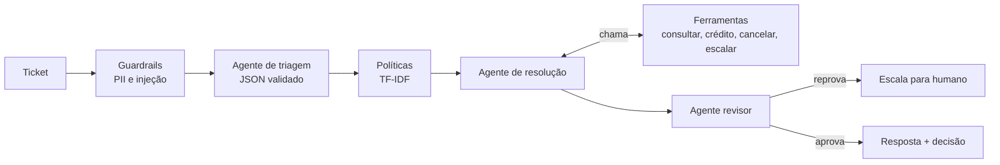

# Comanda

Sistema de agentes de IA para atendimento de um app de delivery (empresa fictícia). Um ticket de cliente entra, passa por
**triagem**, **consulta de políticas**, **resolução com ferramentas** e **revisão**, e sai com uma resposta e uma decisão
(crédito, escalar para humano, cancelar, pedir mais informação, recusar). Python puro, sem dependências.

Feito para mostrar na prática as habilidades pedidas em vagas de **AI Engineer** (integrar e operar LLMs em produtos) e
**AI Builder** (prompt engineering, orquestração de agentes, automações, APIs, análise de dados com IA).



## Tela de demonstração

`python -m comanda serve` e abra `http://127.0.0.1:8787`. À esquerda, um chat com a visão do cliente (inclusive conversas em duas
etapas, como informar o número do pedido depois). À direita, a visão da empresa: guardrails, triagem, políticas, chamadas de
ferramentas com argumentos e resultados, revisão e métricas. Uma aba mostra o resultado da avaliação. Sem a API, a mesma tela abre em
modo demonstração com rastros gravados (`scripts/gerar_web.py`).

## Onde cada requisito das vagas aparece

| O que a vaga pede | Onde está no projeto |
|---|---|
| Prompt engineering avançado | `prompts/`: triagem em duas versões (zero-shot e few-shot com regras de desempate), saída em JSON, ticket delimitado como dado |
| Orquestração de agentes | `comanda/pipeline.py` e `comanda/agentes.py`: três agentes, laço de ferramentas com limite de passos, revisão com reprovação e escalonamento |
| Tool calling / integração de software com produtos de IA | `comanda/tools.py`: esquema de ferramentas, validação de argumentos, regras de negócio **no código** (limite de crédito, crédito único por pedido) e não no prompt |
| Operacionalização de LLMs | `comanda/providers.py`: mesma interface para `simulado`, `ollama` (local) e `anthropic`; reparo automático de JSON inválido; métricas de latência, chamadas e tokens estimados |
| Avaliação de modelos | `comanda/avaliacao.py` e `evals/dataset.jsonl`: 31 casos, acerto por categoria e decisão, relatório em `evals/relatorio.md`, falha no CI se cair abaixo de 90% |
| Segurança (guardrails) | `comanda/guardrails.py`: mascaramento de CPF, e-mail, cartão e telefone antes do modelo; detecção de injeção de prompt que desvia para a fila de segurança |
| Desenvolvimento de APIs sem backend profundo | `comanda/servidor.py`: HTTP com `/tickets`, `/health`, `/metrics`, token opcional, limite de corpo, erros limpos. Contrato em `docs/integracoes.md` |
| Automações (n8n, Make, Zapier) | `n8n/fluxo_comanda.json` (importável) e receitas de Make e Zapier em `docs/integracoes.md` |
| Análise de dados com IA | `comanda/analise.py`: classifica avaliações negativas com o agente de triagem e resume por restaurante (`evals/analise.md` e `.html`) |
| Construir e evoluir com IA | O projeto foi escrito com ajuda do Claude Code, com testes e avaliação para conferir o que a IA produziu |

## Rodar

Requer Python 3.10 ou mais novo.

```bash
python -m comanda ticket "Meu pedido 1002 chegou com 55 minutos de atraso"   # mostra o rastro completo
python -m comanda avaliar                                                     # roda o dataset
python -m comanda analisar                                                    # análise de avaliações
COMANDA_TOKEN=meu-token python -m comanda serve                               # API em 127.0.0.1:8787
python -m unittest discover -s tests                                          # 25 testes
```

```bash
curl -s -X POST localhost:8787/tickets -H "Authorization: Bearer meu-token" \
  -d '{"ticket": "O refrigerante não veio no pedido 1001"}'
```

### Com um modelo de verdade

```bash
COMANDA_PROVEDOR=ollama COMANDA_MODELO=llama3.2 python -m comanda avaliar --versao v1
COMANDA_PROVEDOR=ollama COMANDA_MODELO=llama3.2 python -m comanda avaliar --versao v2
ANTHROPIC_API_KEY=... COMANDA_PROVEDOR=anthropic python -m comanda avaliar
```

Comparar `v1` e `v2` do prompt de triagem só faz sentido assim.

## O que é real e o que não é

- O provedor `simulado` é um conjunto de heurísticas determinísticas escritas por mim. Ele **não lê o prompt**. Serve para
  rodar tudo sem rede nem chave, testar o encanamento (ferramentas, guardrails, revisão, API) e manter o CI verde.
  Os 100% do relatório em `evals/` medem esse encanamento e não a qualidade de um modelo.
- Os provedores `ollama` e `anthropic` seguem a API de cada serviço, mas não foram executados contra um modelo real
  neste repositório.
- Pedidos, políticas e avaliações são dados fictícios. A empresa é inventada e nada aqui usa dados de terceiros.
- O fluxo do n8n está no formato de importação, mas não foi executado numa instância n8n (detalhes em `docs/integracoes.md`).
- A triagem simulada erra reclamações sem palavra-chave conhecida (por exemplo, "embalagem vazou" cai em `fora_de_escopo`).
  Isso aparece na análise de avaliações e é o tipo de lacuna que um modelo real cobre melhor.

## Decisões de projeto

- **Regras de negócio no código.** O modelo pede um crédito; a ferramenta decide se pode. Prompt injection não consegue
  emitir R$ 500 porque o limite não está no prompt (teste `test_injecao_nao_emite_credito`).
- **Saídas do modelo são dados não confiáveis.** Todo JSON é extraído, validado e, se falhar, o agente recebe o erro e tenta de novo.
- **Dado pessoal não chega ao modelo.** A máscara roda antes de tudo, inclusive antes de procurar o número do pedido
  (um bug real que os testes pegaram: um telefone estava sendo lido como número de pedido).
- **Revisor separado.** Uma segunda passada reprova promessas que nenhuma ferramenta confirmou e escala para humano.

## Licença

MIT.
